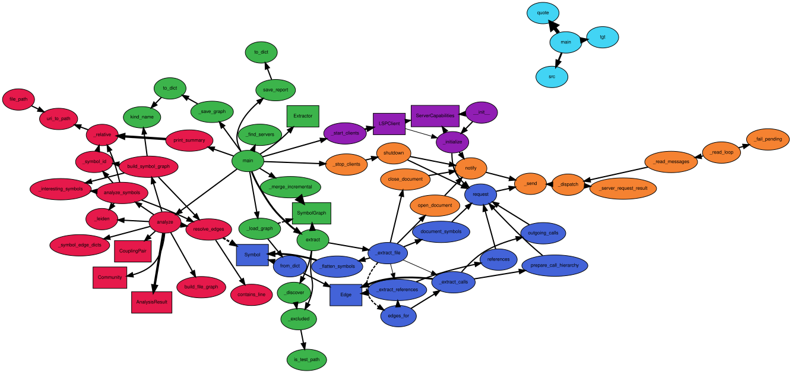

Two external deps (igraph, leidenalg), zero parsing code.

This is CodeGraph, implemented with LSP servers. The idea is to utilize LSP output (which you probably already configured for auto-complete, syntax highlighting etc) and provide network analysis on your code. This should be a fine addition to your Claude skills. Currently only supports `gopls` and `pyright-langserver`.

## Install

```bash
uv tool install codegraph-lsp   # or: pipx install codegraph-lsp
```

This gives you two commands: `codegraph` (extraction and analysis) and `codegraph-dot` (renders a report for Graphviz). Rendering SVGs also needs Graphviz (`sfdp`). The LSP servers for your languages have to be on `PATH`:

```bash
# Python — pyright via uv
uv tool install pyright

# Go — gopls
go install golang.org/x/tools/gopls@latest
```

# Architecture:
- `lsp.py`: JSON-RPC client over stdio. Threads a reader, dispatches responses by ID, ignores server-initiated notifications (diagnostics, logs). Works with any LSP server. ~170 lines replacing whatever tree-sitter glue you had.
- `extract.py`: Drives textDocument/documentSymbol per file, then textDocument/references and callHierarchy/outgoingCalls per interesting symbol (classes, functions, methods, structs). Flattens hierarchical DocumentSymbol responses into qualified names. Skips vendored dirs, `__pycache__`, .pb.go, and test code (`tests/`, `test/`, `testdata/`, `test_*.py`, `*_test.py`, `conftest.py`, `*_test.go`) unless `--include-tests` is given.
- `graph.py`: Collapses symbol-level edges to file-level coupling (undirected, weighted by reference count). Runs Leiden with configurable resolution. Reports communities, modularity score, top coupling pairs.
- `__main__.py` :Two modes: full extraction and --diff (incremental). Incremental loads a previous graph, re-extracts only the listed files, merges, re-runs Leiden.
- `dot.py`: The `codegraph-dot` command: renders a report as Graphviz dot, at symbol, file or community level (see Visualisation).
## Usage on your workstation:
Installed, run `codegraph` directly; from a checkout, through `uv run` as below.
```bash
uv run codegraph /path/to/repo
uv run codegraph /path/to/repo -o report.json --save-graph graph.json
uv run codegraph /path/to/repo --diff src/changed.py --load-graph graph.json
uv run codegraph /path/to/repo --resolution 2.0  # more granular communities
uv run codegraph /path/to/repo --jobs 16         # more concurrent LSP lookups per file (default 8)
uv run codegraph /path/to/repo --include-tests   # also index test code (skipped by default)
uv run codegraph /path/to/repo --exclude 'examples/*' --exclude fakes  # skip more paths
```

`--diff` paths are resolved against the repo root, not the current directory.

In the report's `symbol_graph`, edges point from dependent to dependency (caller -> callee, use site -> definition). Symbols are identified by `source_id`/`target_id` (`<file>::<qualified name>`), since qualified names alone repeat across files.

## Visualisation
Needs graphviz

```bash
codegraph-dot report.json | sfdp -Tsvg -o codegraph.svg
```

From a checkout without installing, `python3 scripts/visualise.py` takes the same arguments.



Drawing every symbol stops being readable at a few hundred nodes (a 22k-line Go CLI already gives 1,200 nodes and 3,500 edges), so `--level` chooses what one node stands for:

| `--level` | One node per | Edges |
|---|---|---|
| `symbol` | function, class, struct… | references with weight ≥ 2, and all calls |
| `file` | file, coloured by the community most of its symbols are in | summed weight between files |
| `community` | symbol community, labelled with its main files | summed weight between communities |
| `auto` (default) | `symbol` up to `--max-nodes` (300) drawn nodes, `community` beyond | |

In the `file` and `community` views a link is drawn only if it is one of the `--top` (default 3) heaviest of one of its ends; a caption counts the ones left out. To zoom into one community:

```bash
codegraph-dot report.json --level community --link 'codegraph-c{id}.svg' | sfdp -Tsvg -o codegraph.svg
codegraph-dot report.json --community 3 --hubs 5 | sfdp -Tsvg -o codegraph-c3.svg
codegraph-dot report.json --drilldowns   # ids of communities worth a page (>= --min-size symbols)
```

`--community N` draws that community's symbols plus one stub per community it links to, with the link weight in each direction. `--hubs K` leaves out the K symbols with the most dependents (the `Client`/`Ctx` types everything touches) and lists them in a legend instead of letting them pull every edge into the middle. `--link` makes each community in the overview a hyperlink to its page; it works when the SVG is opened directly, not through a README ``.

### Across several repos

`scripts/codegraph-svg.sh` renders `codegraph.svg` for each repo it is given and adds a "Call graph" section to that repo's README if it doesn't link the SVG yet. For a graph too large to draw symbol by symbol it writes the community overview there and one page per community under `docs/` (`docs/codegraph-cN.svg`, replacing earlier ones; `--pages DIR` to move them), linked from the overview. Nothing is committed.

```bash
scripts/codegraph-svg.sh ~/src/repo-a ~/src/repo-b
scripts/codegraph-svg.sh --root src/pkg --svg docs/graph.svg --pages docs/graph ~/src/repo-c
```

Nodes colored by _Leiden community_, edge thickness scaled by coupling weight. `sfdp` over `dot` because force-directed handles coupling graphs without a natural hierarchy better: `dot` tries to find a DAG ranking that doesn't exist here.
Symbol views use curved edges (`splines=curved`): graphviz's obstacle-avoiding `splines=true` takes 20s on 300 symbols and minutes on 1,000, against well under a second. The `file` and `community` views are small enough to keep it.

## Known tradeoffs you'll hit:
- The initial extraction is O(interesting_symbols) LSP round-trips, issued concurrently per file (`--jobs`). For a large repo that could still be minutes on first run. Subsequent `--diff` runs are fast :only changed files get re-queried.
- gopls call hierarchy is solid. pyright call hierarchy support is spottier :it implements prepareCallHierarchy but outgoingCalls may return incomplete results for dynamic dispatch. The code degrades gracefully: if call hierarchy isn't available, it falls back to reference-only edges. You get a coupling graph either way, just with less semantic precision on the call direction.
- The _dispatch handler answers server requests (like window/showMessageRequest) with `null` (`workspace/configuration` gets one `null` per item, i.e. "use defaults"). Some servers may not like that. If you see hangs, that's the first place to look.